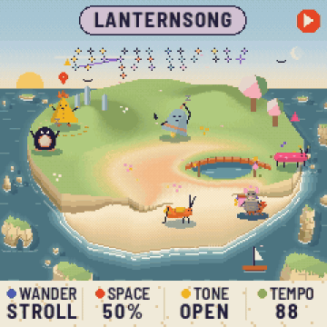
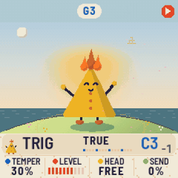
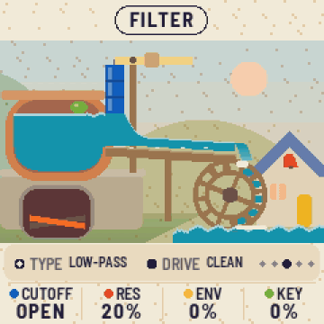
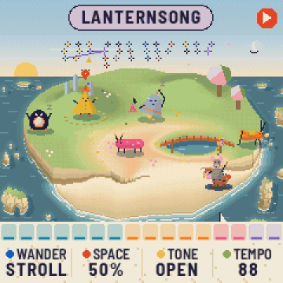
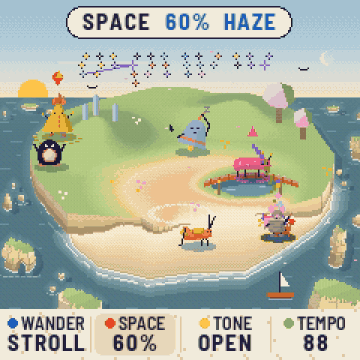

<p align="center"></p>

<p align="center"><b>New firmware for the M-VAVE FM-1. An island that plays music.</b><br>
Open beta · 0.40 beta 1.0.1</p>

<p align="center">
  <a href="https://oodplex.github.io/tonegakko/install/"><b>Install from your browser</b></a> ·
  <a href="https://oodplex.github.io/tonegakko/">The guide</a> ·
  <a href="https://oodplex.github.io/tonegakko/download/tonegakko-0.40.1-beta1-installer.zip">Download the zip</a> ·
  <a href="https://github.com/oodplex/tonegakko/issues/new?template=beta-report.md">Report something</a>
</p>

<p align="center"></p>

An island, printed like a woodblock, where small creatures called the Sonari wander and sing together. What they play together becomes new styles to find, 32 of them, written into the Book as you play. It is a calm little game and a real instrument at once: the keys always play whoever you choose, and MIDI goes in and out.

## Install

You need an FM-1 with its USB cable, and a computer with Chrome or Edge.

1. Plug in the FM-1 and switch it on.
2. Open **[the installer](https://oodplex.github.io/tonegakko/install/)** in Chrome or Edge. When it asks to use MIDI devices, allow it.
3. Follow the page. The FM-1 restarts into Tonegakko, and the boot screen shows `0.40.1-BETA1`.

The same installer can put M-VAVE's own firmware back at any time. Installing is at your own risk. If your FM-1 runs M-VAVE's "FM1 Open" firmware, put the standard firmware back first.

**New in 1.0.1:** it works on the newer FM-1s too. Those sold since autumn 2026 (many from AliExpress, the logo printed on the front) have a different memory chip, a UC25HQ80, which beta 1 did not know. The game is the same as beta 1.

<details>
<summary>Put beta 1 on one of the newer FM-1s?</summary>

On those FM-1s beta 1 plays, but keeps nothing after switching off, and the installer page cannot reach it to update it. Put M-VAVE's firmware back first, then install 1.0.1:

1. Hold **REC** while you switch the FM-1 on. It starts in the chip's own update mode.
2. Plug it into a Mac or Linux computer and run felucca-bsp's rescue in a terminal. It backs the FM-1 up, then writes M-VAVE's own firmware:
   ```sh
   bash -c "$(curl -fsSL https://raw.githubusercontent.com/hugelton/felucca-bsp/main/tools/fm1_rescue.sh)"
   ```
3. Install 1.0.1 from [the installer](https://oodplex.github.io/tonegakko/install/) as usual.

On Windows, or if it does not work, [open an issue](https://github.com/oodplex/tonegakko/issues/new?template=beta-report.md) and we will help.
</details>

<details>
<summary>Installing offline, or from the command line</summary>

Download [the installer zip](docs/download/tonegakko-0.40.1-beta1-installer.zip), unzip it, and serve the folder from a terminal:

```sh
cd tonegakko-0.40.1-beta1-installer && python3 -m http.server 8000
```

Then open `http://localhost:8000/install/` in Chrome or Edge. Or, with [fm1-base](https://github.com/charlesvestal/fm1-base)'s installer (`pip3 install mido python-rtmidi`):

```sh
python3 tools/fm1_install.py tonegakko-0.40.1-beta1.fwsc
```

Checksums: [SHA256SUMS.txt](docs/download/SHA256SUMS.txt)
</details>

## Your first ten minutes

Every button opens its own page, and pressing it again brings you back. Lost? Press **HOME** on any page for a card of everything you can press there. The island also teaches itself, one tip at a time.

| | |
| --- | --- |
|  | **Choose who.** Turn **SELECT**: a ring turns at the chosen one's feet. Or hold **EDIT** and every Sonari shows the button it sits on; press one to choose it. **SEL** lets it rest or brings it back. |
|  | **Look closer and play.** Press **EDIT** for a close-up, then play the keys, soft or hard. Turn **SELECT** there and it becomes another Sonari: there are fourteen. |
|  | **Take the sound apart.** Hold **EDIT** and let go: its SYNTH, five little scenes (an orrery, clockwork, a water mill, a loom, an aquarium) that move as you turn K1 to K4. |
|  | **Shake it up.** Hold **FX** and press white keys: a punch-in for each key, as long as you hold it. |
|  | **Change the weather and the hour.** On the island, K2 brings haze, fog and rain, and K4 the wind. Press **GLO** and turn K1: each key is an hour, from morning into the night. |

Leave it playing and the seasons turn. What the Sonari play together becomes styles in the Book (**GLO**, then THE BOOK).

## Controls at a glance

| Control | What it does |
| --- | --- |
| SELECT | Who is chosen, on the island; on other pages, that page's main choice |
| PRESETS / ALGORITHM | The chosen one's pitch / its phrase |
| K1 K2 K3 K4 | On the island: wander, space (and the weather), tone, tempo (and the wind) |
| SEL | The chosen one joins in, or rests |
| EDIT | Tap: its SOUND page. Hold and let go: its SYNTH page. Hold, then a Sonari's button: choose that Sonari |
| GLO | The island from the sea: key and hour, tuning, swing, tempo, the Book, the settings |
| FX | Tap: the effects. Hold and press white keys: punch-ins |
| ENV / LFO / ARP | Its note shape / its wobble / its pattern |
| SEQ | Its steps. Hold: clear them |
| SAVE | Scenes. Hold and press a white key to keep or call one |
| PLAY / REC | Play or stop (hold: listen) / record a take into the chosen one (hold: undo it) |
| OCT- / OCT+ | The chosen one's octave. Both together: LIVE, the keys conduct everyone |
| Keys | Play the chosen one, soft or hard. MIDI in plays it too |
| HOME | Help, on any page |

## Good to know

- **Settings:** press GLO, then choose SETTINGS: tips, the season, Bluetooth MIDI, MIDI out, a new island.
- **Bluetooth MIDI** is off until you turn it on in the settings.
- **A filter on many Sonari at once** costs the sound engine more. Hold OCT- and OCT+ and press GLO to see the load.
- **The SYNTH scenes' pictures** are still being polished, the orrery most of all. Their sound is final.
- **Follow on a computer:** [the follow page](https://oodplex.github.io/tonegakko/follow/) draws the game in Chrome or Edge from what the FM-1 sends over USB.

## Feedback

This is a beta, so please [open an issue](https://github.com/oodplex/tonegakko/issues/new?template=beta-report.md): what you did, what you expected, what happened instead, and the version on the boot screen. Liked something? Say that too.

## What's here

| Path | What |
| --- | --- |
| `docs/` | The site at [oodplex.github.io/tonegakko](https://oodplex.github.io/tonegakko/): the guide, the installer (`install/`), the follow page (`follow/`), the firmware (`tonegakko-0.40.1-beta1.fwsc`, and in `firmware/` with m-bootloader 1.2) |
| `docs/download/` | The installer zip, for installing offline, and the checksums |
| `LICENSES/`, `NOTICE.md` | The licences of what the firmware and the installer are built from |

Tonegakko is built on [fm1-base](https://github.com/charlesvestal/fm1-base) and felucca-bsp (MPL-2.0); see [NOTICE.md](NOTICE.md). M-VAVE and FM-1 are trademarks of their owners. Tonegakko is not affiliated with M-VAVE.
